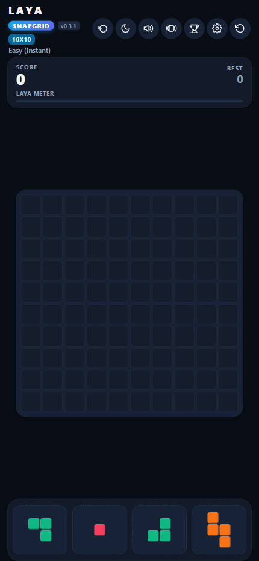
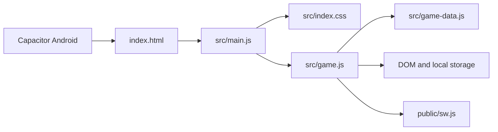

<div align="center">
  
  <h1>Laya Snapgrid</h1>
  <p>An offline, mindful block puzzle for the web and Android.</p>
  <p>
    
    
    
  </p>
</div>

## App preview

<div align="center">
  
</div>

## Features

- Offline-first gameplay with installable web app and Android builds.
- 8×8, 10×10, and 12×12 boards; Easy and Hard modes.
- 46 piece orientations, including two-step, three-step, and diagonal
  staircases.
- 11 Indian languages, synthesized sound, haptics, and selectable palettes.
- One-move undo in Easy mode.
- Local high-score leaderboard.

## Architecture



The HTML file is the page shell. The JavaScript entry imports the stylesheet
and game engine; game definitions, spawn weights, scoring values, translations,
and palettes are kept in `src/game-data.js`.

## Development

**Requirements:** Node.js and npm.

```sh
npm install
npm run dev
```

Create a production web build with `npm run build`; Vite writes it to `dist/`.
Run `npm run lint` for the TypeScript check. Android packaging is available
through `npm run cap:build`.

## Tuning gameplay

Edit `PIECE_SPAWN_WEIGHTS` in `src/game-data.js` to tune each piece
independently. A weight of `0` disables that orientation; higher weights make
it more common. The chance for a piece is its weight divided by the sum of
weights for all enabled pieces.

Current per-orientation weights (each orientation of a group uses the listed weight):

| Piece group | Weight per orientation |
| --- | ---: |
| 1×1 dot, 1×2 bars, 2×2 squares, and small 2×2 corners | 2 |
| 1×3 bars | 1.5 |
| 1×4 bars, 3×3 squares, and five-cell cross | 1 |
| L/J pieces | 0.75 |
| 1×5 bars, large 3×3 corners, T/Z/S pieces, and diagonal stairs | 0.5 |
| Four- and six-tile orthogonal staircases | 0 (disabled) |

The two diagonal staircase pieces are the three-tile patterns `X../.X./..X`
and `..X/.X./X..`; each currently has weight `0.5`. The older orthogonal
staircase definitions remain in the catalog, with their spawn weights at `0`.

Edit `SCORING_CONFIG` in the same file to adjust the score multiplier, points
per tile, cadence bonus and maximum, line-clear base scores, and points for
each line beyond four. The current score multiplier is **0.2** (not 0.3), with
10 raw placement points per tile, resulting in 2 displayed points per tile.
Line-clear base scores are 100, 300, 600, and 1,000 raw points for one to four
lines, plus 400 raw points for each additional line. The active combo streak
multiplies line-clear score; displayed score is rounded down after applying
the score multiplier.

## Piece catalog

- Dot: 1×1.
- Bars: 1×2 through 1×5, horizontal and vertical.
- Squares: 2×2 and 3×3.
- Corners: four rotations each of the 2×2 corner, 3×3 five-cell L, and
  four-cell L and J pieces.
- T family: four T rotations and a five-cell cross.
- Z/S family: horizontal and vertical Z and S, plus two-step and three-step
  orthogonal staircases in horizontal, mirrored horizontal, vertical, and
  mirrored vertical orientations; and two diagonal three-tile staircases
  (`X../.X./..X` and `..X/.X./X..`).

Rows and columns completed together count as separate cleared lines. Combos
increase on consecutive line-clearing placements and reset after two
placements without a clear.

## License

This project is licensed under the [MIT License](LICENSE).
